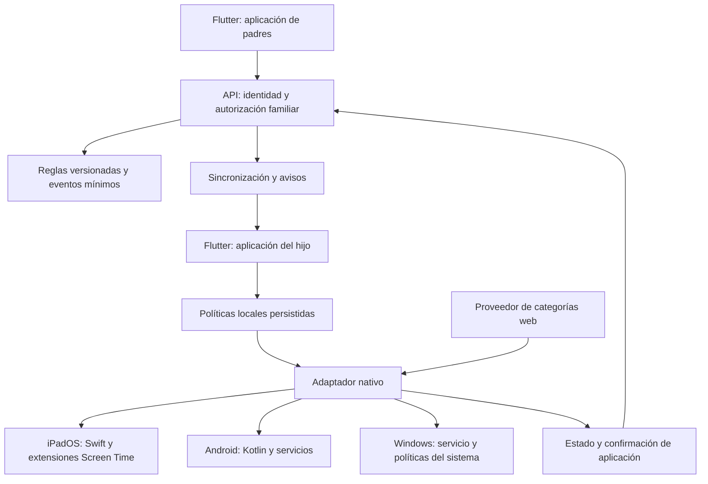

# Arquitectura propuesta

Estado: diseño inicial sujeto a resultados de fase 0. Fecha: 2026-10-23.

## Objetivo y alcance

Actualizacion: se admite sesion compartida padre/hijo y se exige contrasena del responsable para desbloquear. Ver [ADR 0002](decisiones/0002-sesion-compartida-y-contrasena.md). El servicio Windows mantiene restricciones al cerrar la interfaz; su implementacion queda pendiente. La cuenta infantil separada es recomendacion de resistencia, no requisito del modo inicial.

Administrar reglas familiares desde dispositivos compatibles y aplicarlas localmente en equipos de los hijos. La paridad de interfaz no implica paridad de capacidades. El producto mostrará qué restricciones están disponibles, activas o degradadas en cada equipo.

La primera versión contempla categorías web, excepciones de dominios, bloqueo de aplicaciones donde sea viable, horarios y solicitudes de acceso. Quedan fuera la inspección de chats, capturas de pantalla, interceptación TLS y clasificación universal de imágenes o videos dentro de otras aplicaciones.

## Componentes

El diagrama representa responsabilidades; el mecanismo final de distribución de categorías y el acceso de cada extensión al estado se decidirán en los prototipos. Las notificaciones despiertan la sincronización cuando sea posible; no constituyen garantía de entrega ni ejecutan el bloqueo por sí mismas.

| Componente | Responsabilidad | Límite |
| --- | --- | --- |
| App de padres | Configurar familia, reglas, horarios y excepciones | No controla remotamente el sistema por sí sola |
| App del hijo | Vinculación, permisos, explicación del bloqueo y solicitudes | Su proceso puede cerrarse |
| Motor de reglas | Resolver reglas y producir una política por capacidad | No concede permisos del sistema |
| Adaptador nativo | Aplicar políticas, informar permisos y verificar estado | Sujeto a restricciones del sistema |
| API | Aislamiento entre familias, versiones y sincronización | No participa en cada apertura de aplicación |
| Proveedor web | Clasificación actualizable de dominios | No identifica cada publicación dentro de una app |

## División del código

- `apps/parent_app`: interfaz Flutter para responsables.
- `apps/child_app`: interfaz Flutter y proyectos anfitriones por plataforma.
- `packages/policy_core`: modelo y evaluación de reglas en Dart, sin dependencias de interfaz.
- `packages/platform_contracts`: capacidades, errores y mensajes entre Flutter y código nativo.
- `packages/platform_adapters`: plugins propios; Swift y Kotlin dentro de sus plataformas. En Windows, puente al servicio mediante IPC autenticado con permisos restringidos.
- `services/control_api`: identidad, vinculación, políticas y confirmaciones. Lenguaje, base de datos y alojamiento pendientes de decisión.

Las extensiones de Apple, los servicios Android y el servicio Windows deben ejecutar sus tareas sin depender de un motor Flutter activo. Compartiremos reglas declarativas y pruebas de conformidad; la ejecución nativa no puede asumir que Dart continúa corriendo en segundo plano.

## Contratos propuestos

Contratos conceptuales; aún no son una API implementada.

- `DeviceCapabilities`: plataforma, versión, modo de instalación, permisos y capacidades (`appBlocking`, `webFiltering`, `scheduling`, `tamperStatus`). Cada capacidad indica disponible/no disponible/degradada, motivo y alcance.
- `Policy`: identificador, versión creciente por dispositivo, fecha de emisión, zona IANA, horarios, categorías, excepciones y referencias locales a aplicaciones.
- `ApplyResult`: versión solicitada, versión aplicada, resultados por capacidad, error y fecha de verificación.
- `ProtectionStatus`: última verificación local, última comunicación con servidor y causas de degradación. Equipo sin conexión no equivale a equipo sin protección.

Los identificadores de aplicaciones son específicos de plataforma. Los tokens opacos de Apple se conservarán en el ámbito permitido por sus API; no se presupone que puedan convertirse en nombres de paquetes ni compartirse entre equipos.

## Reglas y sincronización

1. El responsable autenticado modifica una política dentro de su familia.
2. El servidor autoriza el acceso y publica una nueva versión para el dispositivo.
3. El equipo descarga, valida y persiste la política antes de aplicarla.
4. El adaptador aplica únicamente las capacidades admitidas y comprueba su estado.
5. El servidor registra la confirmación. La interfaz distingue pendiente, aplicada, parcial y fallida.

Las operaciones serán idempotentes; no se reemplaza una versión vigente por una antigua. Una política aplicada sigue vigente sin conexión. Se evaluará firma de políticas y protección local de claves antes de producción.

Propuesta de precedencia: restricciones esenciales del sistema > bloqueo manual explícito > excepción web explícita > categoría web > comportamiento predeterminado. Una excepción web no desbloquea una aplicación. Los horarios intersectan las condiciones de uso. La fase 1 fijará la semántica de cuotas, cambios de zona, reloj alterado y conflictos; no implementar reglas ambiguas.

## Particularidades nativas

- **iPadOS:** Family Controls, Managed Settings y Device Activity; extensiones Swift y almacenamiento compartido según lo permita Apple. Probar autorización infantil real, restricciones web, alcance entre navegadores y permiso de distribución para cada target que lo necesite. MDM queda fuera del modo familiar inicial.
- **Android:** `VpnService` para explorar filtrado; comparar instalación convencional y dispositivo administrado. La suspensión de paquetes requiere roles admitidos por el sistema. Un perfil de trabajo no representa control de todo el dispositivo. No basar el producto en accesibilidad sin verificar necesidad, fiabilidad y política de publicación.
- **Windows:** servicio instalado con elevación y app sin privilegios; explorar WFP para red y AppLocker/App Control para ejecución según edición y alcance por usuario. Evaluar primero componentes del sistema; no iniciar con un driver propio. Nunca interpretar bloqueo de internet como bloqueo de ejecución.

## Filtrado y recuperación

DNS filtra dominios, no rutas HTTPS ni publicaciones individuales. Evaluar DNS cifrado, VPN de terceros, IP directa, cachés, navegadores y redes móviles. Una regla en el router será una capa opcional; la protección fuera del hogar depende del equipo.

La indisponibilidad del proveedor web no debe cortar toda la red silenciosamente. La fase 0 medirá caché local y recuperación; la fase 1 decidirá el comportamiento por categoría con indicación visible de degradación. Los bloqueos manuales ya descargados se conservarán. Debe existir recuperación autorizada por el responsable y reversión de las políticas de prueba.

## Seguridad y privacidad

Vinculación mediante código de un solo uso con caducidad; permisos verificados en servidor por familia, rol y dispositivo. Un cliente infantil no puede convertirse en responsable modificando su almacenamiento. Revocación de dispositivos y credenciales, secretos en almacenes del sistema y comunicaciones cifradas.

Recoger estado y eventos agregados; evitar URL completas con parámetros, contenido y nombres personales en registros. Retención, borrado, exportación y autorización del responsable se definirán antes del piloto. No subir evidencias con datos de menores al repositorio público.

Amenazas a probar: hijo con cuenta estándar, revocación de permisos, detención de servicios, desinstalación, cambio de reloj, otra VPN, otra red y órdenes de otro usuario. Administrador local, root o jailbreak quedan fuera de una garantía de resistencia; documentar su efecto observado.
